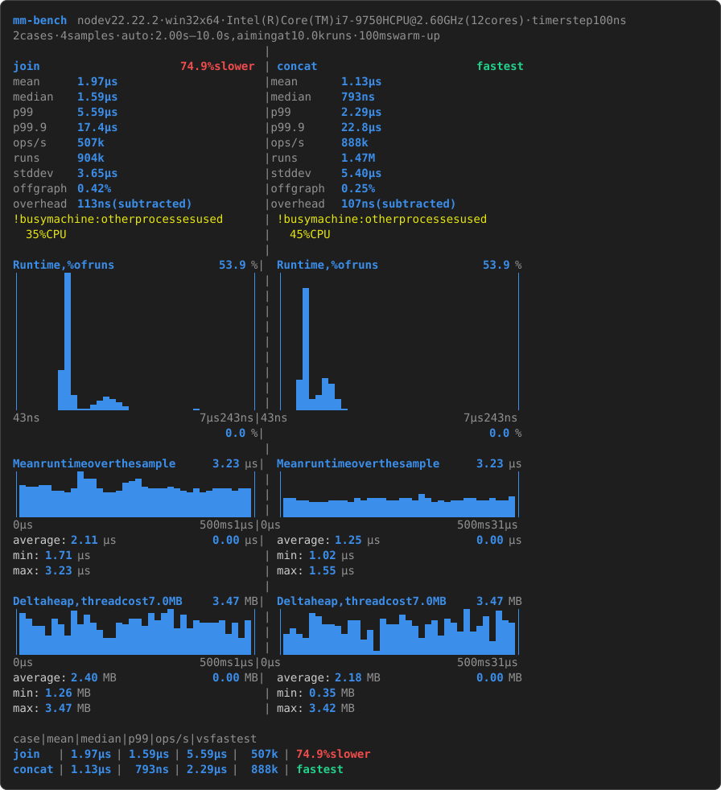

# @mmutils/bench

Microbenchmarks with run time distributions. Every run is timed on its
own, in fresh worker threads, with CPU and memory probes between runs; the
compared cases are plotted side by side with
[@mmutils/logger](https://www.npmjs.com/package/@mmutils/logger), on shared
scales, so the case that stands out shows at a glance.

- **Distributions, not just means**: an exact histogram of every run's
  time, plotted as percent of runs per time bucket. 30% of runs at 200 ns,
  60% at 400 ns and 10% at 600 ns show as three peaks.
- **Isolated**: each sample is a fresh worker with its own heap and JIT
  state, and the samples of compared cases are interleaved (A B, B A, …),
  so drift and warm-up are shared fairly.
- **Honest about the hardware**: the timer's resolution and its own cost
  are measured at runtime, never assumed; the overhead is subtracted, and
  the report hints at a batch size when runs are shorter than the timer
  can tell apart.
- **CPU and memory over time**: the function's thread, all the process's
  threads, the machine's cores, and the heap above the thread's own cost.
- **All the raw data**: `output: false` returns the report with every
  histogram, tick and probe, to plot or store your own way.
- **ESM and CommonJS**, with type declarations.

## Install

```sh
npm install --save-dev @mmutils/bench
```

Requires Node.js 22 or newer.

## Quick start

```js
// bench/strings.js, run with: node bench/strings.js
import { bench, compare } from '@mmutils/bench';

// prepared at the top level: the workers run this file too
const words = Array.from({ length: 50 }, (_, index) => `word${index}`);

await compare(
  bench('join', () => words.join(' ')),
  bench('concat', () => {
    let text = '';
    for (const word of words) text += word + ' ';
    return text;
  })
);
```

It prints a column per case, side by side, with its stats and graphs, then
a summary of the cases. Here three of the six default graphs, from one run
on a laptop (your numbers will differ):



<details>
<summary><sub>The output above as plain text</sub></summary>

<!-- output:compare -->

```text
mm-bench  node v22.22.2 · win32 x64 · Intel(R) Core(TM) i7-9750H CPU @ 2.60GHz (12 cores) · timer step 100ns
2 cases · 4 samples · auto: 2.00s–10.0s, aiming at 10.0k runs · 100ms warm-up
                                       |
join                      74.9% slower | concat                         fastest
mean      1.97µs                       | mean      1.13µs
median    1.59µs                       | median    793ns
p99       5.59µs                       | p99       2.29µs
p99.9     17.4µs                       | p99.9     22.8µs
ops/s     507k                         | ops/s     888k
runs      904k                         | runs      1.47M
stddev    3.65µs                       | stddev    5.40µs
off graph 0.42%                        | off graph 0.25%
overhead  113ns (subtracted)           | overhead  107ns (subtracted)
! busy machine: other processes used   | ! busy machine: other processes used
  35% CPU                              |   45% CPU
                                       |
Run time, % of runs             53.9 % | Run time, % of runs             53.9 %
│       █                            │ | │                                    │
│       █                            │ | │   █                                │
│       █                            │ | │   █                                │
│       █                            │ | │   █                                │
│       █                            │ | │   █                                │
│       █                            │ | │   █                                │
│      ▅█                            │ | │   █  ▁                             │
│      ██                            │ | │  ██  █▆                            │
│      ███▁▁▃▅▇▆▄▂          ▁        │ | │  ██▆███▆▁                          │
43ns                         7µs 243ns | 43ns                         7µs 243ns
                                 0.0 % |                                  0.0 %
                                       |
Mean run time over the sample  3.23 µs | Mean run time over the sample  3.23 µs
│▁  ▁▁    █▄▄    ▂▃▄                 │ | │                                    │
│█████▆▆▅▇███▇▅▅▆████▇▇▇█▇▆▅▇▅▆▇▇▇▆▇▇│ | │▂▂▁▁   ▁▁▁ ▂▁▂▂▂▁▁▂▂▁▄▂ ▁ ▁▁▂▂▁▁▂▁▁▃│
│████████████████████████████████████│ | │████████████████████████████████████│
0µs                          500ms 1µs | 0µs                         500ms 31µs
average: 2.11 µs               0.00 µs | average: 1.25 µs               0.00 µs
min: 1.71 µs                           | min: 1.02 µs
max: 3.23 µs                           | max: 1.55 µs
                                       |
Delta heap, thread cost 7.0 MB 3.47 MB | Delta heap, thread cost 7.0 MB 3.47 MB
│▆▃   ▃  ▇ ▅▁   ▁ ▃▃ ▆▂▆█ ▅ ▂▁▁▁▂ ▁ ▂│ | │    ▆▄    ▂▂   ▃  ▅▂   ▂ ▃▁ █  ▄ ▇▂▁│
│██▇▇▂██▂████▅▁▁████▇████▆█▆█████▃█▁█│ | │▃▆▃▁████▇▃██ ▅ █████▇▁██▂██▄█▄▇█ ███│
│████████████████████████████████████│ | │██████████████▂█████████████████▇███│
0µs                          500ms 1µs | 0µs                         500ms 31µs
average: 2.40 MB               0.00 MB | average: 2.18 MB               0.00 MB
min: 1.26 MB                           | min: 0.35 MB
max: 3.47 MB                           | max: 3.42 MB

case   |   mean | median |    p99 | ops/s | vs fastest
join   | 1.97µs | 1.59µs | 5.59µs |  507k | 74.9% slower
concat | 1.13µs |  793ns | 2.29µs |  888k | fastest
```

<!-- /output -->

<sub><i>Bars and frames may not line up in this text if your font lacks the block characters; the image shows the real alignment.</i></sub>

</details>

## How it works

- A **case** is a named function, created by `bench`. Nothing runs until
  it is passed to `compare` or its `run` is called.
- A **run** is one timed call (or one batch of calls, see `batchSize`).
- A **sample** is one fresh worker measuring one case. Each case gets 4
  samples by default, and the samples of compared cases are interleaved.
- A **tick** is one CPU and memory probe, taken between runs, never inside
  one.

The workers get your functions by running your bench file again: each one
imports it, runs it up to the call it measures (earlier calls resolve right
away there, with an empty report), measures its case and is stopped. Then:

- **Code before a call runs in every worker**: prepare the data your cases
  use at the top level, as usual. Skip work they don't need, like writing
  files or starting servers, with `if (!isWorker())`.
- **Code after the last call runs only once**, on the main thread.
- **Calls must be the same on every run of the file**: the workers find
  their call by its position among the calls of the file, and check that
  its cases have the same names.
- Calls run one at a time, even when they are started together.

Each sample measures the timer's overhead first (empty runs timed the same
way), calls the function once to tell whether it's async (any thenable is
awaited, on every call), warms it up in the measuring loop itself, collects
the garbage, then times runs until its budget is spent.

## Writing benchmarks

- **Return the result of the work** (`() => format(input)`, not
  `() => { format(input); }`): it is stored, so V8 can't drop the call as
  dead code.
- **Measure functions slower than the timer**, or batch them: the header
  prints the timer's step, which depends on the hardware and the OS (often
  100 ns on Windows).
  With `batchSize: 100`, a run is timed as a whole and recorded per call,
  so the step per call is a hundred times finer, at the cost of a smoother
  distribution. The report suggests a batch size when runs are too short.
- **Start the file with node**: the workers run the entry script by
  default. From a test runner, a REPL, or a file the entry imports, pass
  `{ file: import.meta.url }` (or `__filename` in CommonJS).
- **CommonJS without top-level await** works too: chain the calls with
  `then`, and pass `file: __filename` to calls outside the entry script.
- Keep the machine quiet: when other processes use 10% of the machine's
  CPU or more while a case is measured, the case gets a warning.

## API

### `bench(name, fn, options?)`

Creates a case. `name` must be unique among the cases of a call; `fn` is
sync or async. `options` are the measure options below, for this case only;
they win over the call's.

`bench(...).run(options?)` measures the case alone: the same as
`compare(theCase, options)`.

### `compare(...cases, options?)`

Measures the cases side by side and resolves with the `Report`. `options`
take the measure options, for every case of the call, and these:

| Option   | Default          | What it does                                                                                                                             |
| -------- | ---------------- | ---------------------------------------------------------------------------------------------------------------------------------------- |
| `file`   | the entry script | File the workers import to get the cases: a path or a `file:` URL, see [Security](#security).                                            |
| `root`   | `process.cwd()`  | Directory `file` must be inside, once symlinks are resolved.                                                                             |
| `output` | `true`           | `true` prints with `loggerReporter()`, `false` prints nothing (the report has all the data), or pass a reporter (`loggerReporter({…})`). |

### Measure options

| Option             | Default         | What it does                                                                                                                                                                                                                                                   |
| ------------------ | --------------- | -------------------------------------------------------------------------------------------------------------------------------------------------------------------------------------------------------------------------------------------------------------- |
| `time`             | `'auto'`        | Measured time of the case in ms, split between its samples. `'auto'` (or `{ min, max, runs }`, default `{ min: 2000, max: 10_000, runs: 10_000 }`) estimates a run's time during the warm-up and measures long enough for `runs` runs, within `min` and `max`. |
| `runs`             | –               | Exact number of measured runs instead of a time, split between the samples (at least one each).                                                                                                                                                                |
| `samples`          | `4`             | Fresh workers per case.                                                                                                                                                                                                                                        |
| `warmup`           | `{ time: 100 }` | Warm-up of each sample in ms (`{ time }`) or runs (`{ runs }`), after a first call.                                                                                                                                                                            |
| `batchSize`        | `1`             | Calls per timed run, recorded as the time per call.                                                                                                                                                                                                            |
| `subtractOverhead` | `true`          | Subtract the timer's own cost (measured by each sample, reported in `overhead`) from the stats and the distribution. Histograms keep the raw times.                                                                                                            |
| `tickInterval`     | `10`            | Milliseconds between CPU and memory probes.                                                                                                                                                                                                                    |
| `timeout`          | `60_000`        | Milliseconds a sample may go without progress before its worker is stopped and the call rejects: catches endless loops and promises that never settle. Progress comes between runs, so a single run may take up to about three quarters of it.                 |

`DEFAULT_MEASURE_OPTIONS` and `DEFAULT_AUTO_TIME` hold the defaults.

### `isWorker()`

`true` in mm-bench's measuring workers, which run your bench file again.
Use it to skip work the cases don't need; data the cases use must still be
prepared.

### `loggerReporter(options?)`

The default reporter: a header, a line per finished sample, then a column
per case with its stats, hints and graphs, side by side, and a summary
table of the cases.

| Option     | Default                   | What it does                                                                                                                             |
| ---------- | ------------------------- | ---------------------------------------------------------------------------------------------------------------------------------------- |
| `graphs`   | `DEFAULT_GRAPHS`          | Graphs of each case, top to bottom, from `GRAPH_NAMES`. Add `'machine'` with `[...DEFAULT_GRAPHS, 'machine']`.                           |
| `summary`  | `DEFAULT_SUMMARY`         | Table of the cases after their graphs, two or more cases: fields from `SUMMARY_FIELDS`, e.g. `[...DEFAULT_SUMMARY, 'runs']`, or `false`. |
| `width`    | the terminal's, split     | Width of each case's column.                                                                                                             |
| `columns`  | as many as fit at 40 wide | Cases side by side; more continue below.                                                                                                 |
| `buckets`  | `'cols'`                  | Buckets of the distribution: one per graph column, or a number.                                                                          |
| `trim`     | `0.001`                   | See `distribution`.                                                                                                                      |
| `rows`     | `9`                       | Rows of the distribution graph; the others take a third.                                                                                 |
| `progress` | `true`                    | Print a line per finished sample.                                                                                                        |
| `colors`   | `true` unless `NO_COLOR`  | Paint with colors.                                                                                                                       |
| `write`    | `console.log`             | Line destination.                                                                                                                        |

@mmutils/logger is loaded only when the reporter prints, so `output: false`
and the workers never load it.

### `distribution(report, options?)`

The run times of a report's cases in equal buckets over one shared range,
ready to plot: time on the X axis, percent of runs on the Y axis. Bucket
widths are whole multiples of the timer's step, so runs the timer can't
tell apart never leave empty buckets between full ones.

- `buckets` (default `30`): number of buckets, usually the graph's columns.
- `trim` (default `0.001`): the fastest and slowest share of each case's
  runs left out of the range, then sparse edge buckets, so rare outliers
  (GC pauses, preemption) don't squeeze the other runs into a few buckets.
  They are counted in `below` and `above`.

```js
import { Logger, graphPlugin } from '@mmutils/logger';
import { bench, distribution } from '@mmutils/bench';

const numbers = Array.from({ length: 100 }, (_, index) => (index * 7919) % 101);
const report = await bench('sort', () =>
  [...numbers].sort((a, b) => a - b)
).run({ output: false });
const { start, end, cases } = distribution(report, { buckets: 40 });
new Logger({ plugins: [graphPlugin()] }).infoGraph(cases[0].percents, {
  title: 'sort',
  unit: '%',
  axis: { start, end, unit: 'ns' },
});
```

### Other exports

- `caseSeries(samples, columns, options?)`: a case's ticks resampled to
  `columns` windows of the sample and averaged over the samples: the data
  of the graphs over the sample.
- `computeStats(histogram, shift?)` and `mergeHistograms(histograms)`: the
  stats of a histogram, and histograms added up.
- `GRAPH_NAMES`, `DEFAULT_GRAPHS`, `SUMMARY_FIELDS`, `DEFAULT_SUMMARY`,
  `DEFAULT_BUCKETS`, `DEFAULT_TRIM`, `MACHINE_WINDOW`, and every type of
  the report and options.

## The report

```ts
interface Report {
  cases: CaseReport[]; // in the order they were passed
  environment: Environment; // Node, OS, CPU, cores, timer resolution
  duration: number; // wall time of the call, ms
}

interface CaseReport {
  name: string;
  async: boolean;
  options: ResolvedMeasureOptions; // defaults filled in
  stats: Stats; // mean, min, max, median, p75, p99, p999, stdDev, opsPerSecond, runs
  relative: number; // mean relative to the fastest case: 1.5 is 50% slower
  overhead: number; // timer cost per call
  histogram: Histogram; // { durations, counts }: every run, exactly
  samples: SampleReport[]; // per worker: histogram, ticks, machine probes
}
```

Times are in nanoseconds per call, options in milliseconds. Ticks are
cumulative counters (CPU time, runs, timed time) plus memory levels, as
columns: the rate between any two ticks is their difference. The JSDoc of
each type has the details.

## Reading the graphs

Graphs over the sample show their average, min and max under the bars;
the number on the title row is the top of the scale, shared by the
compared cases, so the case that stands out shows.

- **Run time, % of runs**: the distribution. Peaks are the typical times;
  a long tail on the right is GC pauses, preemption or slow paths.
- **Mean run time over the sample**: JIT tier-ups, GC pauses and drift.
- **Function's thread**, 0–100% of a core: the worker thread calling the
  function. Sync work keeps it near 100%; it drops while the function
  waits for I/O, timers or other threads.
- **All cores usage**, in percent of all the machine's cores: the whole
  process, every thread: the function's, V8's garbage collector and
  compiler, libuv's thread pool (async file I/O, crypto, zlib) and
  mm-bench's main thread. One busy thread on 12 cores is 8%.
- **Delta heap**: the worker's V8 heap above its thread cost, the heap it
  holds when measuring starts, right after a full garbage collection (V8's
  own, the modules, your file's data; about 6–8 MB). What rises above 0 is
  the case's: garbage piling up until a collection, or retained memory as
  a rising trend. Fast cases show a floor of about 1 MB: the timer
  allocates on every read (Node 22 has no nanosecond timer that doesn't),
  the same for every case.
- **Total heap used**: the same with the thread cost, which hides small
  footprints.
- **Machine cores**, not drawn by default: every logical core of the
  machine, all processes, from `os.cpus()`. Threads move between cores, so
  one busy thread can show as several partly busy cores. `other processes`
  is what the rest of the machine used meanwhile.

Windows counts CPU time in steps of 15.6 ms, so its CPU graphs use windows
of at least 62.5 ms (125 ms for the machine's cores).

## Security

The workers import a file and run it, so mm-bench checks it first: it must
be a path or a `file:` URL (`data:`, `http:` and other URLs are rejected),
a regular `.js` `.mjs` `.cjs` `.ts` `.mts` or `.cts` file, inside `root`
once symlinks and junctions are resolved. The check runs on the main
thread; the workers import the resolved real path.

Case names and the CPU's name are escaped in the report and in error
messages, so they can't send terminal escape sequences. Errors your cases
throw, and the end of a failed worker's stderr, are passed on as they are.

To measure the heap right after a full garbage collection, mm-bench needs
V8's `gc`. Unless Node runs with `--expose-gc`, it turns the V8 flag on for
the moment it takes `gc` from a new context, and off again, as Jest does.
V8 flags belong to the process: a context another thread creates in that
moment gets a `gc` too. If V8 doesn't give it, measuring goes on without
the collection.

## Demos

[`demo/`](demo/README.md) has a complete bench script for each feature:
distributions, comparisons, async cases, batches, CPU on one and on all
cores, memory, and the raw data with your own plot.

## AI use

@mmutils/bench is developed with AI assistance: most of the code, tests
and documentation was written with AI. The author designs the features,
makes the decisions and reviews the changes, and every change passes the
same checks (formatting, lint, strict type checking and tests) before it is
committed.

## License

[MIT](LICENSE)
